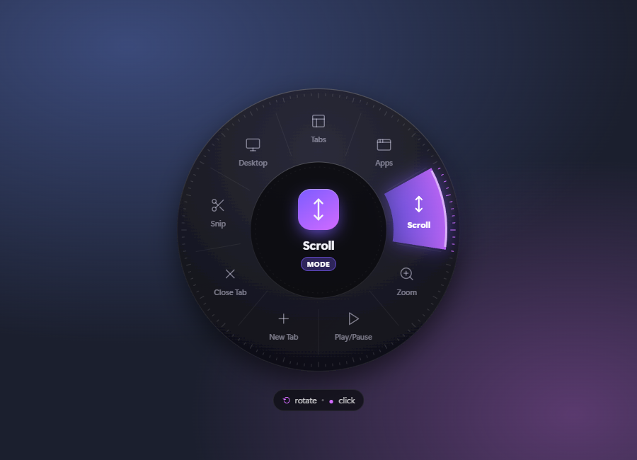
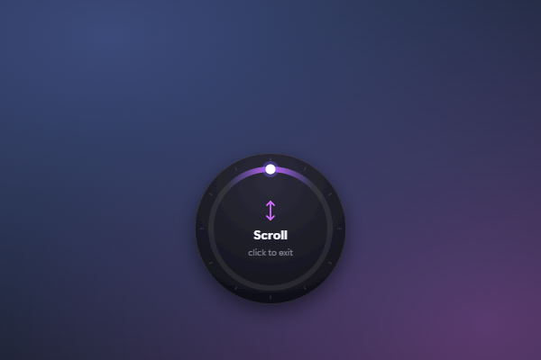

# Knob Orbit

A radial on-screen dial for the AULA 75 knob (Windows).

## Screenshots

The orb after rotating to **Scroll**:

The smaller indicator while Scroll mode is active:

## Controls

- Click or rotate the knob to open the orb. Rotation also moves the selection.
- Click the knob while the orb is open to run the selected action or enter a mode.
- In a mode, rotate to use that control; click again to exit.
- The orb closes after six seconds without input. Rotation opens it again.
- While the app is running, the knob never mutes or changes system volume. Windows sees the knob as volume keys, so volume keys on other keyboards are also captured.
- Without a knob, use ← / → or Enter to open the orb. Then use ← / → to move, Enter to select, and Esc to close.

## Run
1. Install Node.js LTS from nodejs.org
2. Double-click `START.bat` (first run installs everything)
3. Right-click the purple tray icon for **Start with Windows**, **Edit dial items**, and **Quit**. Turn on **Start with Windows** if you want the app to launch after sign-in.

`npm run preview` opens the UI in a browser (Enter / arrows) for tweaking the look.

## Customise — `orbit.config.json`
- `icon`: any name from lucide.dev/icons in PascalCase (e.g. `Github`, `Music`)
- `type: "keys"` + `keys: "ctrl+shift+t"`
- `type: "open"` + `target: "https://youtube.com"` or `"notepad"` or `"C:\\Projects"`
- `type: "mode"` + `mode: "tabs" | "apps" | "scroll" | "zoom" | "media"`
- `accent`: two colours for the gradient

After editing, tray → *Reload items*.

To refresh the screenshots after changing the UI, run `npm run build:ui` and then `node_modules\.bin\electron.cmd scripts\capture-screenshots.cjs`.
